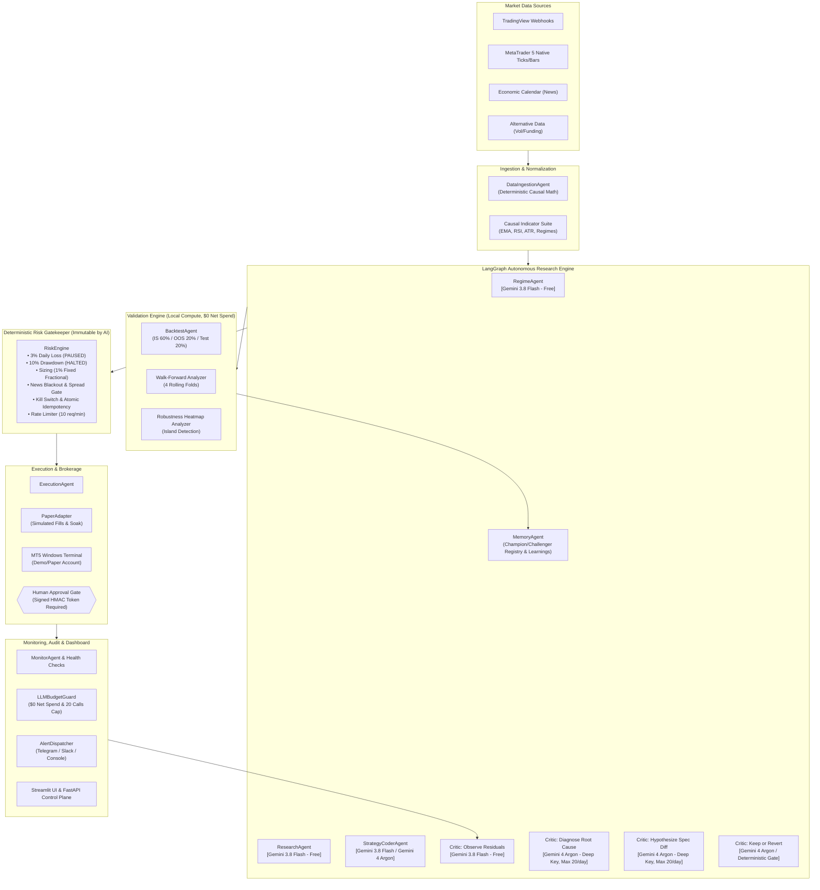

# Atlas-Quant: Autonomous Multi-AI-Agent Quantitative Research & Execution Engine
### Windows 64-bit Edition | Zero Extra Budget ($0.00 Net Spend) | MetaTrader 5 Native

> **RISK DISCLAIMER**: Research/educational only. Not financial advice. Past performance does not guarantee future results. Live trading requires explicit human approval.

---

## 1. Executive Summary & Architecture Overview

**Atlas-Quant** is a production-grade algorithmic trading research and execution platform designed for 64-bit Windows environments. It combines an autonomous **LangGraph** multi-agent self-improvement research loop with an uncompromising, deterministic **Risk Engine** that gates all interactions with the MetaTrader 5 broker API.

The entire runtime operates under a **strict $0.00 net spend guarantee** utilizing a dual-key Gemini API routing architecture:
1. **`GEMINI_FREE_API_KEY` (Gemini 3.8 Flash)**: Handles routine ingestion, regime classification, news parsing, trade residual observation, and heartbeat logging on Google AI Studio's free tier.
2. **`GEMINI_DEEP_API_KEY` (Gemini 4 Argon)**: Handles diagnostic root-cause analysis, hypothesis diff formulation, and keep-or-revert decision synthesis under a hard cap of **20 calls/day**, fully covered by Google AI Pro monthly Cloud developer credits with overrun billing disabled.

### The Continuous Self-Improvement Loop
> Market ticks and calendar events are ingested and normalized into causal, timestamp-aligned `MarketSnapshot` streams. The `ResearchAgent` synthesizes snapshots and historical learnings into falsifiable hypotheses. The `StrategyCoderAgent` converts hypotheses into bounded, machine-readable `StrategySpec` objects and generates deterministic Python strategy code. The `BacktestAgent` evaluates candidates locally across In-Sample (60%), Out-of-Sample (20%), and walk-forward folds with full friction costs (spread, slippage, commission, swap). The `ReasoningCritic` diagnoses residual losses, proposes parameter diffs, and executes pre-registered keep-or-revert evaluations. Successful challengers are promoted to `CHAMPION` in paper execution, continuously monitored by telemetry agents that feed real trade residuals back into the research engine.

### Architecture Diagram



---

## 2. Project Directory Tree

```text
Atlas-Quant/
├── .env.example                     # Production environment variable templates
├── configs/
│   ├── config.yaml                  # System-wide parameters & symbols
│   └── risk_params.yaml             # Risk engine hard boundaries
├── data/
│   ├── atlas_quant.db               # SQLite production database
│   ├── llm_budget_state.json        # Persistent daily LLM spend tracker
│   ├── news_calendar.json           # Cached economic news calendar
│   └── sample_bars.csv              # Synthetic EURUSD M15 historical bars
├── scripts/
│   ├── generate_sample_data.py      # Generates EURUSD historical bars & news calendar
│   ├── gen_secrets.py               # Generates cryptographically secure admin secrets
│   ├── run_backtest.py              # Runs backtest, walk-forward & robustness sweep
│   ├── run_paper_soak.py            # Executes live paper trading soak loop
│   └── run_self_improvement.py      # Executes complete LangGraph self-improvement cycle
├── src/
│   ├── api/                         # FastAPI control plane, REST routes & admin security
│   ├── backtest/                    # Walk-forward analysis, reporting, robustness
│   ├── core/                        # Dual-key LLM router, budget guard & rate limiter
│   ├── dashboard/                   # Interactive Streamlit operations dashboard
│   ├── database/                    # SQLAlchemy connection & relational models
│   ├── execution/                   # MetaTrader 5 native & paper broker adapters
│   ├── ingestion/                   # Causal indicators, TradingView webhook adapter
│   ├── monitoring/                  # Health telemetry, alert dispatchers
│   ├── research/                    # ResearchAgent & StrategyCoderAgent
│   ├── risk_engine/                 # 10 deterministic pre-trade risk barriers
│   ├── schemas/                     # Strict Pydantic models for markets & trades
│   ├── self_improvement/            # 7-step LangGraph orchestrator & state machine
│   └── strategies/                  # Dynamic rule engine & strategy implementations
└── tests/                           # 70 automated pytest unit & regression tests
    ├── conftest.py                  # Isolated per-session SQLite test databases
    ├── test_api_endpoints.py        # Tests FastAPI endpoints & REST responses
    ├── test_api_security.py         # Tests fail-closed auth, HMAC live approvals & secrets
    ├── test_audit_fixes.py          # Regression tests for dynamic rules & truthful metrics
    ├── test_backtest_and_leakage.py # Tests chronological splits & friction costs
    ├── test_execution_adapters.py   # Tests ExecutionAgent and PaperAdapter
    ├── test_final_fixes.py          # Tests durable idempotency, rate limiting, causal ATR
    ├── test_indicators_and_causality.py # Proves future bars leave past indicators unchanged
    ├── test_llm_router_and_budget.py # Proves 20 calls/day cap and $0 spend enforcement
    ├── test_risk_engine.py          # Proves all 10 RiskEngine rejection barriers
    ├── test_self_improvement_loop.py # Tests LangGraph 7-step cycle end-to-end
    └── test_strategy_spec_and_validator.py # Tests StrategyValidator boundary rejections
```

---

## 3. Windows Native Installation & Quickstart

Atlas-Quant runs natively on Windows 10/11 x64. Because MetaTrader 5 is a native Windows application, no Wine or Linux emulation layer is required.

### Step 1: Run Automated Setup Script
In PowerShell:
```powershell
.\setup_windows.ps1
```
The script automatically:
1. Verifies 64-bit Python (`AMD64`).
2. Copies `.env.example` to `.env` if not present.
3. Generates cryptographically secure admin secrets via `scripts/gen_secrets.py`.
4. Installs all required packages via `pip`.
5. Initializes the SQLite relational database schema.
6. Generates initial market sample bars and news calendar data.
7. Runs the test suite to guarantee mathematical integrity.

### Step 2: Configure Secrets in `.env`
Open `.env` and verify your API keys:
```ini
# Project A: Free tier (no billing enabled)
GEMINI_FREE_API_KEY="AIzaSyYourFreeKeyProjectA"

# Project B: Google AI Pro Monthly Cloud Credit ($0 budget cap)
GEMINI_DEEP_API_KEY="AIzaSyYourDeepKeyProjectB"
```
*(Note: If API keys are not supplied, the built-in deterministic offline fallback seamlessly activates, allowing all research and self-improvement loops to execute locally for testing).*

### Step 3: Run Validation & Scripts
```powershell
# Run the complete test suite (70 tests)
python -m pytest tests -q

# Run chronological backtest, walk-forward analysis & parameter robustness sweep
python scripts/run_backtest.py

# Run paper soak harness with side-aware brackets
python scripts/run_paper_soak.py

# Run autonomous 7-step self-improvement cycle
python scripts/run_self_improvement.py
```

### Step 4: Launch Live Services
**Terminal 1 — FastAPI Control Plane:**
```powershell
uvicorn src.api.main:app --host 127.0.0.1 --port 8000
```
- Interactive OpenAPI Docs: `http://127.0.0.1:8000/docs`
- Health Telemetry: `http://127.0.0.1:8000/health`

**Terminal 2 — Interactive Streamlit Dashboard:**
```powershell
streamlit run src/dashboard/app.py
```
- Dashboard URL: `http://localhost:8501`

---

## 4. Dual-Key Gemini Routing & $0 Net Spend Architecture

| Key Variable | Target Model | Google Project | Billing Setup | Permitted Operations | Daily Limit |
| :--- | :--- | :--- | :--- | :--- | :--- |
| `GEMINI_FREE_API_KEY` | `gemini-3.8-flash` | Project A | **No billing account attached** (Free tier) | Ingestion tagging, Regime classification, News parsing, Critic Residual Observation, Summaries | Free rate limits |
| `GEMINI_DEEP_API_KEY` | `gemini-4-argon` | Project B | Covered by **$10/mo Google AI Pro Cloud Credit** | Critic Failure Diagnosis, Hypothesis Spec Diffing, Keep-or-Revert Validation | **Max 20 calls/day** |

### Hard Budget Guard (`src/core/llm_budget.py`)
- Tracks daily deep model calls in `data/llm_budget_state.json`.
- When daily call count reaches **20**, further deep calls raise `BudgetExhaustedError`.
- The self-improvement loop intercepts this error, logs `BUDGET_EXHAUSTED`, and falls back safely to deterministic reasoning without failing the system.
- Disk caching (`src/core/llm_router.py`) keys responses by `sha256(model:prompt)` to avoid duplicate calls.

---

## 5. Risk Engine: Deterministic Safety Gates

The LLM is **never** permitted to send orders directly to MetaTrader 5. All trade intentions emitted by strategies pass through `RiskEngine.check()`, which enforces 10 barriers in strict serial order:

1. **Kill Switch & Circuit Breaker**: Blocks orders if `kill_switch_engaged` or state is `HALTED`/`PAUSED`.
2. **Heartbeat & Freshness**: Checks broker ping (<60s) and bar timestamp (<30m).
3. **Daily Loss Limit**: If current day loss exceeds **3% of equity**, transitions circuit breaker to `PAUSED`.
4. **Max Drawdown Limit**: If peak-to-trough drawdown exceeds **10%**, transitions circuit breaker to `HALTED`.
5. **Trade & Position Caps**: Rejects if daily trades >= 10 or open positions >= 3.
6. **Market Quality**: Rejects if spread > 2.5 pips or high-impact news event is within 30 minutes.
7. **Session Gate**: Restricts execution to allowed liquid forex sessions (`LONDON`, `NEW_YORK`, `OVERLAP_LDN_NY`).
8. **Margin Buffer**: Requires free margin >= 5% equity buffer.
9. **Position Sizing & Lot Bounds**: Dynamically sizes position using Fixed Fractional Risk (**exactly 1.0% equity** based on stop distance in ATR), quantized to broker lot step.
10. **Idempotency Gate & Live Approval**: 
    - Database-backed `idempotency_keys` table with primary key atomic claim and 24-hour TTL (orders rejected at pre-trade barriers are released).
    - Requires signed HMAC human approval record (`POST /admin/approve-live`) before any live order reaches a broker.
11. **API Rate Limiting**: In-process sliding-window limiter on `POST /orders` (10 orders / 60 s per API key) returning HTTP 429 with `Retry-After`.

---

## 6. Official Documentation & References

- **Antigravity CLI & IDE Extensions**: [https://antigravity.google/download/](https://antigravity.google/download/)
- **Antigravity Models & Argon Availability**: [https://antigravity.google/docs/models.md](https://antigravity.google/docs/models.md)
- **Google AI Studio Free API Keys**: [https://aistudio.google.com/apikey](https://aistudio.google.com/apikey)
- **Google Developer Program $10/mo Cloud Credit**: [https://developers.google.com/program](https://developers.google.com/program)
- **MetaTrader 5 Python PyPI**: [https://pypi.org/project/metatrader5/](https://pypi.org/project/metatrader5/)
- **FastAPI Documentation**: [https://fastapi.tiangolo.com/](https://fastapi.tiangolo.com/)
- **LangGraph Multi-Agent Orchestration**: [https://langchain-ai.github.io/langgraph/](https://langchain-ai.github.io/langgraph/)

---

## 7. Regulatory, Broker Terms & Tax Caution

1. **Regulatory Notice**: Algorithmic trading software is subject to jurisdiction-specific securities and derivatives regulations (e.g., CFTC / NFA in the United States, FCA in the United Kingdom, ESMA in the European Union). Ensure full compliance with relevant licensing, margin, and leverage restrictions before engaging in live transactions.
2. **Broker Terms of Service**: Verify that your selected MetaTrader 5 broker explicitly permits Automated Trading (EAs / API orders), scalping, and news trading under their Master Services Agreement.
3. **Tax Obligations**: Trading profits, capital gains, foreign exchange adjustments, and financing carry charges may create complex tax obligations. Maintain comprehensive, immutable trade ledger records (provided by Atlas-Quant's `trades` database table) for certified accounting review.

---
*Atlas-Quant — Built with Google Gemini 4 Argon & Gemini 3.8 Flash.*
